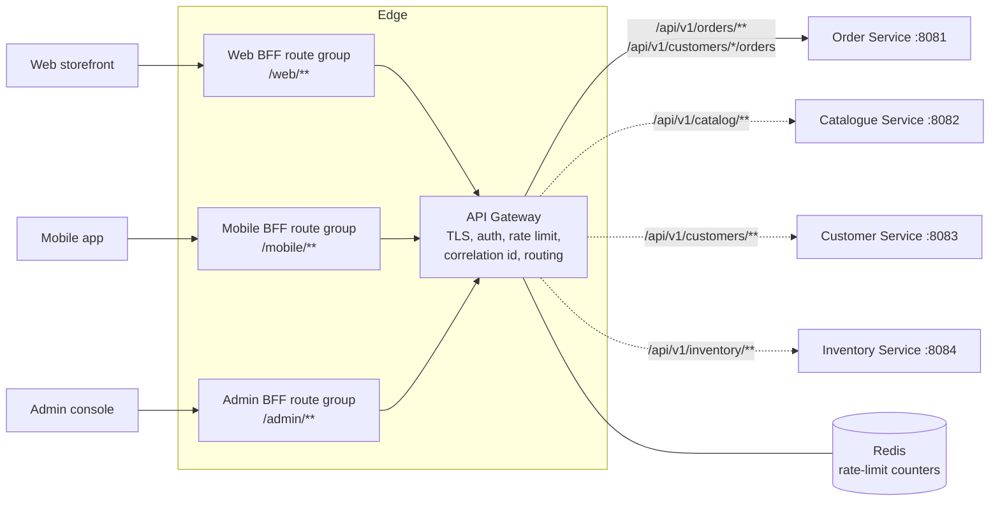

# API Gateway Sketch (Bonus L9)

A design sketch, not running code. It shows the single entry point that sits in front of the Order Service and, later, the other services from [service-decomposition.md](service-decomposition.md).

## Why a gateway

Once there is more than one deployable, clients should not know which service owns which URI, and each service should not reimplement TLS, authentication and rate limiting. The gateway owns those cross-cutting concerns. It contains **no business logic**: it routes, limits and forwards.



The Payment Service has no route: it is driven by events only and is never reachable from outside.

## Routing table

Routes are matched top to bottom. Order matters for row 2.

| # | Public path | Methods | Target | Notes |
|---|---|---|---|---|
| 1 | `/api/v1/orders/**` | POST, GET, PUT | Order Service `:8081` | Exists today |
| 2 | `/api/v1/customers/{customerId}/orders` | GET | Order Service `:8081` | The order history belongs to the Order Service, although the path starts with `/customers`. Must be listed before row 4 |
| 3 | `/api/v1/catalog/**` | GET | Catalogue Service `:8082` | Planned; served by the monolith until extracted |
| 4 | `/api/v1/customers/**` | GET, PUT | Customer Service `:8083` | Planned |
| 5 | `/api/v1/inventory/**` | GET | Inventory Service `:8084` | Planned; read-only from outside |
| 6 | `/swagger-ui.html`, `/v3/api-docs/**` | GET | Not routed in production | API documentation stays internal |

## Rate limiting

Token bucket per client, counted in Redis so that every gateway instance sees the same numbers. The key is the authenticated user id, or the IP address for anonymous calls.

| Route | Refill per second | Burst | Reason |
|---|---|---|---|
| `POST /api/v1/orders` | 5 | 10 | A person does not place more than a few orders per second; protects the write path from scripts |
| `GET /api/v1/orders/**`, order history | 50 | 100 | Order status polling |
| `GET /api/v1/catalog/**` | 200 | 400 | Browsing is the bulk of the traffic and is cacheable |
| Admin routes | 20 | 40 | Few users, expensive queries |

A limited request gets `429 Too Many Requests` with a `Retry-After` header and an RFC 7807 body, the same error format as the services use.

## Backend-for-Frontend segmentation

Different clients need different shapes of the same data. Instead of adding client-specific fields to the Order Service, each client type gets a thin BFF route group at the edge.

| BFF | Client | What it does differently |
|---|---|---|
| Web BFF `/web/**` | Browser storefront | Composes one "order page" response from Order + Catalogue (product name and image per SKU). Cookie session |
| Mobile BFF `/mobile/**` | Mobile app | Smaller payloads (order summaries only), longer cache times, token authentication |
| Admin BFF `/admin/**` | Back office | May list orders of any customer; stricter authentication; lower rate limits |

The services stay client-neutral: the Order Service returns orders with SKUs, and only a BFF knows that the web page also wants product names.

## Other gateway responsibilities

- **Authentication.** Validates the token once and forwards the user id in a header. Services trust the gateway's network, not the client.
- **Correlation id.** Creates `X-Correlation-Id` if the client sent none, so one request can be followed across services and onto the side-channel thread (Milestone 3 observability).
- **Timeouts.** 2 s for `POST /orders`, 1 s for reads. The gateway answers `504` instead of holding a connection open.
- **Circuit breaker.** After repeated failures of one service, the gateway fails fast for that route only, so a broken Catalogue cannot use up the connections that order placement needs.

## Route definition (Spring Cloud Gateway)

```yaml
spring:
  cloud:
    gateway:
      default-filters:
        - AddRequestHeader=X-Gateway-Forwarded, true
      routes:
        - id: order-service-orders
          uri: http://order-service:8081
          predicates:
            - Path=/api/v1/orders/**
          filters:
            - name: RequestRateLimiter
              args:
                redis-rate-limiter.replenishRate: 50
                redis-rate-limiter.burstCapacity: 100
                key-resolver: "#{@userKeyResolver}"
            - name: CircuitBreaker
              args:
                name: orderService
                fallbackUri: forward:/fallback/unavailable

        # Must come before customer-service: the order history is owned by the Order Service.
        - id: order-service-customer-orders
          uri: http://order-service:8081
          predicates:
            - Path=/api/v1/customers/{customerId}/orders
            - Method=GET
          filters:
            - name: RequestRateLimiter
              args:
                redis-rate-limiter.replenishRate: 50
                redis-rate-limiter.burstCapacity: 100
                key-resolver: "#{@userKeyResolver}"

        - id: catalogue-service
          uri: http://catalogue-service:8082
          predicates:
            - Path=/api/v1/catalog/**
          filters:
            - name: RequestRateLimiter
              args:
                redis-rate-limiter.replenishRate: 200
                redis-rate-limiter.burstCapacity: 400
                key-resolver: "#{@userKeyResolver}"

        - id: customer-service
          uri: http://customer-service:8083
          predicates:
            - Path=/api/v1/customers/**
```

The stricter limit for `POST /api/v1/orders` (5 per second) would be a second route with a `Method=POST` predicate placed above `order-service-orders`; it is left out here to keep the sketch short.

## Costs of the gateway

- It is a single point of failure, so it must run as at least two instances behind a load balancer.
- Every request pays one extra network hop.
- It is tempting to put business rules into gateway filters. The rule here is that anything about orders, prices or stock belongs to a service.
