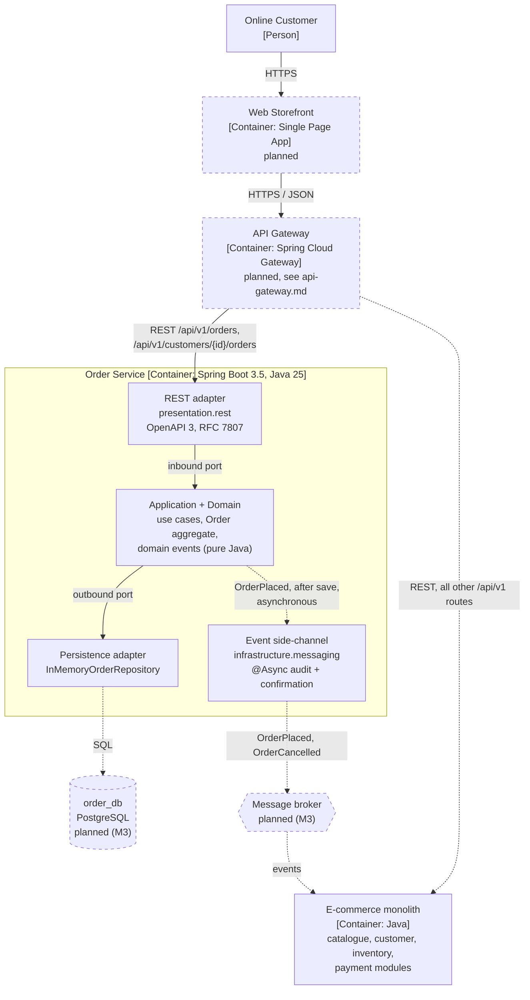

# M2 Milestone Technical Close

Closed on 2026-11-22 with the Week 10 work (`feature/distributed-slice` -> `m7-distributed`).

Milestone 2 took the order subsystem from one legacy endpoint to a domain-driven, hexagonal service with a published REST contract. This document freezes what Milestone 3 builds on. Anything listed under "Locked" changes only through a new ADR.

## 1. Verified baseline

| # | Item | Evidence |
|---|---|---|
| 1 | Strategic bounded contexts and ubiquitous language | [contexts.md](contexts.md) |
| 2 | Tactical domain model: immutable value objects, `Order` aggregate root with invariants, domain events | `com.ecommerce.order.domain`, 68 pure domain tests |
| 3 | Hexagonal ports and adapters, framework-free domain | [ADR-0006](adr/0006-hexagonal-ports-adapters.md), `HexagonalArchitectureFitnessTest` (10 rules) |
| 4 | Service decomposition with database-per-service isolation | [service-decomposition.md](service-decomposition.md) |
| 5 | REST API: 5 endpoints on noun URIs, status codes 201 (+ `Location`), 200, 204, 400, 404, 409, RFC 7807 errors | `OrderRestController`, `OrderRestControllerContractTest` (18 tests) |
| 6 | springdoc OpenAPI 3 at `/swagger-ui.html` and `/v3/api-docs`, snapshot committed | [openapi/rest-endpoints.json](openapi/rest-endpoints.json), `OpenApiSnapshotContractTest` |
| 7 | Asynchronous event side-channel, isolated from request latency and failures | `infrastructure.messaging`, `SideChannelIsolationIntegrationTest` |
| 8 | Distributed slice decision with a non-extraction rationale | [ADR-0007](adr/0007-monolith-to-distributed-slice.md), `DistributedSliceArchitectureFitnessTest` (11 rules) |
| 9 | Green build | `./mvnw clean verify`: 160 tests, 0 failures, compiled with `-Xlint:all` and no warnings |

## 2. C4 container view at M2 close

Solid boxes and arrows exist in the code today. Dashed ones are planned. The Order Service and the monolith have **no** direct arrow between them, in either direction; that is checked by ArchUnit.

## 3. Locked

- **Context boundaries.** Order Processing (Core), Inventory (Supporting), Payment (Generic), plus Catalogue and Customer as supporting services.
- **Container topology.** The Order Service is its own deployable with its own data. The remaining modules stay in the monolith until they are extracted in the order given in [service-decomposition.md](service-decomposition.md).
- **Domain model and invariants.** The `Order` aggregate, its value objects, the lifecycle `DRAFT -> PLACED -> PAID / CANCELLED`, and the 10,000 order limit.
- **Dependency rules.** The domain depends on the JDK only. Adapters depend inwards. Driving adapters use the inbound port.
- **REST contract `/api/v1`.** The five operations and their status codes as committed in the OpenAPI snapshot. A breaking change needs `/api/v2`.
- **Integration style.** Synchronous REST for client requests. Asynchronous events for reactions between services. The Order Service makes no synchronous call to another service while placing an order.

## 4. Known gaps handed to Milestone 3

| Gap at M2 close | Milestone 3 topic |
|---|---|
| Orders are stored in memory and are lost on restart; no optimistic locking | PostgreSQL `order_db` adapter behind `OrderRepository` |
| Side-channel events are in-process and can be lost | Messaging: transactional outbox and a broker adapter behind `DomainEventPublisher` |
| No correlation id; the audit line is on another thread than the request | Observability: OpenTelemetry tracing, metrics for the side-channel queue |
| No timeouts, retries or circuit breakers (nothing to call yet) | Resilience, once the Order Service consumes `PaymentProcessed` |
| `PUT /orders/{id}/payment` is called by a client | Replaced by the `PaymentProcessed` event from the Payment Service |
| No authentication or rate limiting | API gateway ([api-gateway.md](api-gateway.md)) |
| Only the Order Service is extracted | Payment, then Inventory, then Catalogue and Customer |

## 5. Sign-off

- [x] `./mvnw clean verify` green on `feature/distributed-slice`
- [x] ADR-0007 written, including the service that was not extracted
- [x] OpenAPI snapshot committed and matching the running service
- [x] `[W10] distributed-slice` pull request merged (solo project: no peer reviewer)
- [x] ADR-0006 and ADR-0007 status changed from Proposed to Accepted
