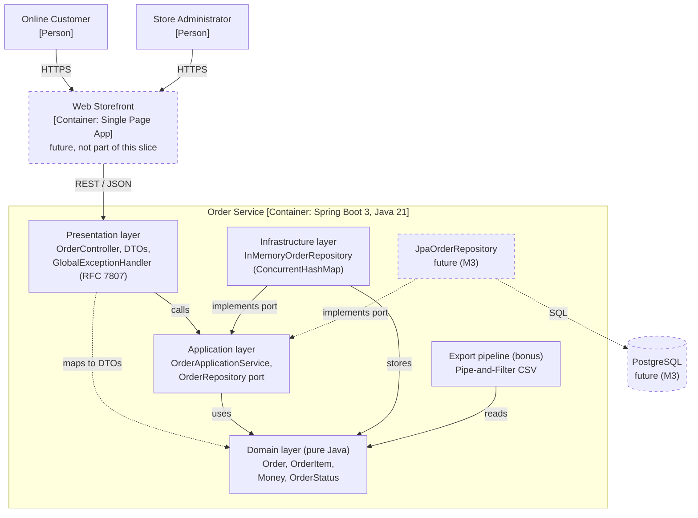

# M2 Progress Note

During this milestone, I moved order handling from the single legacy endpoint into a layered Spring Boot 3 service on Java 21, with separate presentation, application, domain, and infrastructure packages. The controller now only maps validated DTOs and returns RFC 7807 errors, the pricing and status rules live in pure Java domain classes, and storage sits behind an `OrderRepository` port with an in-memory adapter. ArchUnit rules enforce the dependency direction and the absence of package cycles in every build. The container view below reflects this decomposition; PostgreSQL and the JPA adapter are planned for M3 and do not exist yet. See [ADR-0005](adr/0005-layered-mvc-for-orders.md) for the decision and its costs.

## C4 Container View: Order Subsystem

Solid arrows exist in the code today. Dashed boxes and the dashed arrows leading to them are planned. The dashed arrow from presentation to domain is the one read-only dependency that exists today, for mapping responses.
