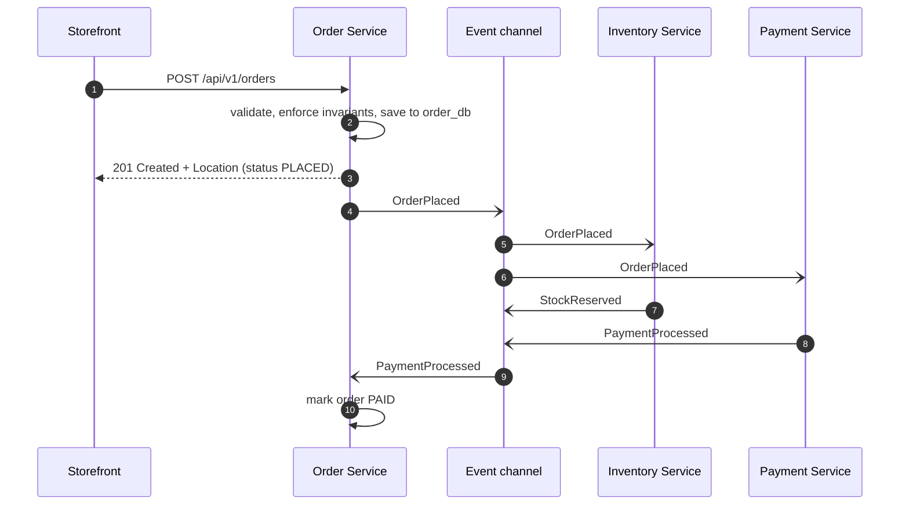

# Service Decomposition: Monolith to Distributed Services

Week 10, Block A (`m7-distributed`). This is the paper exercise that comes before the code: where the e-commerce monolith is cut, who owns which data, and how the pieces talk. The decision itself is recorded in [ADR-0007](adr/0007-monolith-to-distributed-slice.md).

**What is real today:** only the Order Service is extracted and runs as its own Spring Boot application (`com.ecommerce.order`). The other four services are the target design; their code still lives in the monolith package `mn.edu.num.sad.ecommerce`. Databases are the target too: the Order Service stores orders in memory until the PostgreSQL adapter arrives in Milestone 3.

## 1. Starting point: the monolith

Checkout in the monolith is one synchronous call chain inside one process, `CheckoutFacade.checkout()`:

```text
CheckoutFacade --> InventoryService.isAvailable / reserve
               --> PaymentGateway.charge
               --> OrderService.createOrder
```

Problems this causes once the modules are owned by different people:

- **Deployment lockstep.** A change to catalogue caching redeploys checkout.
- **One failure domain.** A slow payment provider holds a request thread and a database connection that order placement also needs.
- **Shared data.** Every module can read every table, so a schema change in one module can break another without a compile error.

## 2. Target services

Five bounded services. Each maps to one bounded context from [contexts.md](contexts.md) or one module of the monolith.

| Service | Subdomain type | Owns (private database) | Inbound API | Outbound communication | Monolith code it replaces |
|---|---|---|---|---|---|
| **Order Service** (extracted) | Core | `order_db` (PostgreSQL): orders, order lines, address and price snapshots | REST `/api/v1/orders`, `/api/v1/customers/{id}/orders` | Publishes `OrderPlaced`, `OrderCancelled` (async) | `checkout.OrderService`, `com.ecommerce.order` |
| **Catalogue Service** | Supporting | `catalog_db` (PostgreSQL): products, descriptions, list prices | REST `/api/v1/catalog` | Publishes `ProductPriceChanged` (async) | `catalogue.*`, `product.*` |
| **Inventory Service** | Supporting | `inventory_db` (PostgreSQL): stock levels, reservations | REST `/api/v1/inventory` (read stock); event listener for `OrderPlaced`, `OrderCancelled` | Publishes `StockReserved`, `StockReservationFailed`, low-stock alerts (async) | `checkout.InventoryService` |
| **Customer Service** | Supporting | `customer_db` (PostgreSQL): profiles, addresses, tiers | REST `/api/v1/customers` | None. Queried synchronously by the gateway and clients | `customer.*` |
| **Payment Service** | Generic | `billing_db` (PostgreSQL): charges, refunds, provider references | Event listener for `OrderPlaced`, `OrderCancelled` | Publishes `PaymentProcessed`, `PaymentFailed` (async); calls the external payment provider (sync, behind an ACL) | `checkout.PaymentGateway` |

Notification and audit are deliberately **not** in this table. They were evaluated as a sixth service and kept inside the Order Service; ADR-0007 explains why.

## 3. Database-per-service rules

1. **One owner per table.** A service reads and writes only its own database. No shared tables, no shared schema, no shared connection pool.
2. **No cross-service SQL.** There is no join between `order_db` and `customer_db`. If a service needs another service's data, it asks through that service's API or keeps its own copy from events.
3. **References, not foreign keys.** The Order Service stores a `customerId` and a `sku` as plain values. Nothing in `order_db` enforces that the customer or product still exists.
4. **Snapshots instead of joins.** What an order needs later is copied into the order when it is placed, and never updated afterwards:

| Data | Owner (source of truth) | Copy in `order_db` | Why a copy |
|---|---|---|---|
| Shipping address | Customer Service | `ShippingAddress` value object on the order | The parcel goes to the address given at checkout, even if the profile changes later |
| Unit price | Catalogue Service | `unitPrice` on each order line | The customer pays the price agreed at checkout, not today's list price |
| Product name, image | Catalogue Service | Not copied; only the `sku` | The client joins the order with the catalogue for display |

5. **Schema migrations are private.** The Catalogue team can rename a column without telling the Order team, because the only contract between them is the REST and event schema.

In the code, `DistributedSliceArchitectureFitnessTest` already enforces the class-level version of this rule: the Order Service and the monolith packages may not depend on each other in either direction.

## 4. Communication: synchronous REST versus asynchronous events

**Rule of thumb:** a client that waits for an answer uses REST. A service that reacts to something that already happened uses an event. The Order Service never makes a synchronous call to another service while placing an order.

| Interaction | Style | Why |
|---|---|---|
| Storefront -> Order: place order, read order, list a customer's orders | Sync REST | The checkout page needs an immediate `201` or a `400` it can show |
| Storefront -> Catalogue / Customer: browse products, read profile | Sync REST | Queries; a person is waiting |
| Order -> Inventory: reserve stock for a placed order | Async event `OrderPlaced` | Recording the order must not fail because inventory is slow |
| Order -> Payment: start the charge | Async event `OrderPlaced` | Payment providers are slow and outside our control |
| Payment -> Order: payment result | Async event `PaymentProcessed` (today `PUT /orders/{id}/payment` stands in for it) | Order reacts when the fact arrives |
| Order -> Inventory / Payment: release stock, refund | Async event `OrderCancelled` (carries the previous status) | Compensation does not need the customer to wait |
| Order -> audit trail and customer confirmation | Async in-process side-channel on `OrderPlaced` | Implemented this week; see Block C |

### Why not chain the calls synchronously

If placing an order called Inventory, Payment and Customer over REST one after another, the request would depend on four services at once. With 99% availability and 100 ms per service:

- availability: 0.99^4 = 96.1%, which is about 14 days of failed checkouts per year instead of 3.7;
- latency: 4 x 100 ms = 400 ms before any retry.

With events, placing an order depends on the Order Service alone: 99% and 100 ms.

### Place-order flow (target)



Steps 1 to 3 are synchronous and are what the customer waits for. Everything after step 3 is eventual.

## 5. What the cut costs

- **Eventual consistency.** For a short time an order is `PLACED` while stock is not yet reserved. If the reservation fails, the order must be cancelled by a compensating event; there is no rollback across databases.
- **Duplicated data.** Address and price snapshots can differ from the current profile and catalogue. That is intended, but support staff must know which copy they are looking at.
- **No cross-service transactions.** Pay, cancel and refund across Order, Payment and Inventory become a saga in Milestone 3.
- **Events can be lost today.** The channel is in-process and not durable. A transactional outbox and a broker are Milestone 3 work.

## 6. Extraction order

| Step | Slice | Status |
|---|---|---|
| 1 | Order Service with REST contract, OpenAPI and event side-channel | Done (this week) |
| 2 | PostgreSQL `order_db`, outbox and message broker for the Order Service | Milestone 3 |
| 3 | Payment Service (clearest boundary, already behind `PaymentGateway`) | After the broker exists |
| 4 | Inventory Service | After Payment |
| 5 | Catalogue and Customer Services | Last; they are read-mostly and cause the least pain in the monolith |
